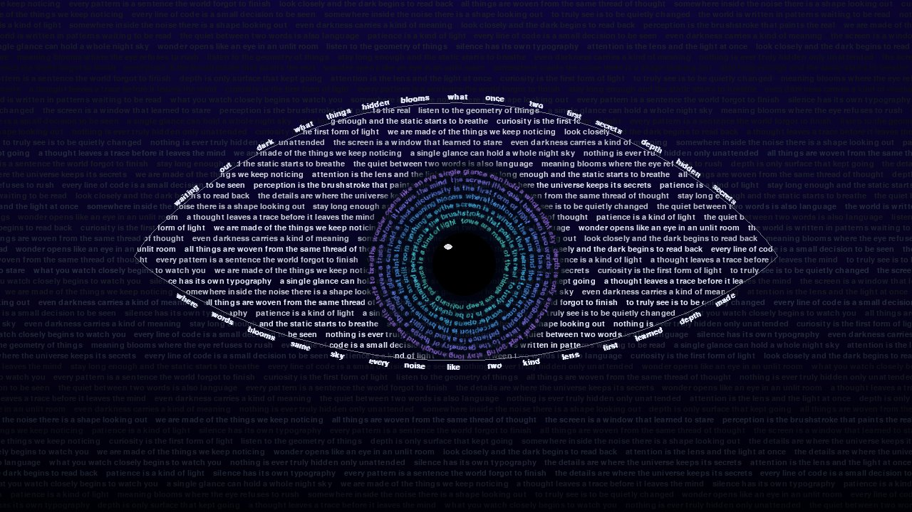

# Eye Within Words

An eye made entirely of text. Rows of drifting sentences flare bright inside an almond-shaped lid, the iris is a stack of rotating text rings, and every few seconds it blinks.

Built with Python + pygame, compiled to WebAssembly with [pygbag](https://github.com/pygame-web/pygbag) so it runs in the browser.

**Live demo:** _add your Vercel URL here_



## Controls

| Input | Action |
|---|---|
| `SPACE` / click / tap | Blink |
| `B` | Toggle auto-blink |
| `Z` | Toggle breathing zoom |
| `C` | Next palette (midnight, ember, violet, mono) |
| `R` | Reseed: new text layout |
| `H` | Toggle help |
| `ESC` | Quit (desktop only) |

Move the mouse and the iris follows you. Leave it alone and the gaze wanders.

## Run locally

```bash
pip install -r requirements.txt
python main.py
```

## Build for the web

```bash
pip install pygbag==0.9.3
python -m pygbag --build .     # static site in build/web/
python -m pygbag .             # or: build + local test server at http://localhost:8000
```

Deployed on Vercel straight from this repo. `vercel.json` runs the pygbag build and serves `build/web/`.

## How it works

- **Text rows:** each row is pre-rendered twice, dim and bright, and scrolled by offset. The bright copy is drawn through a per-row clip rect whose width comes from inverting the lid curve, so the eye shape needs no per-pixel masking.
- **Iris:** concentric rings of glyphs, each laid along its circumference and rotated every frame, then masked to the eye polygon with `BLEND_RGBA_MULT`.
- **Blink:** a small state machine: lids slam shut (ease-in), hold, then glide open (ease-out), with an occasional double blink.

## Headless test

```bash
SDL_VIDEODRIVER=dummy python main.py --test-frames 62 --screenshot-dir shots
```

Saves frames 20 (open), 41–43 (closing / closed) and 60 (reopened).

## License

[MIT](LICENSE)
